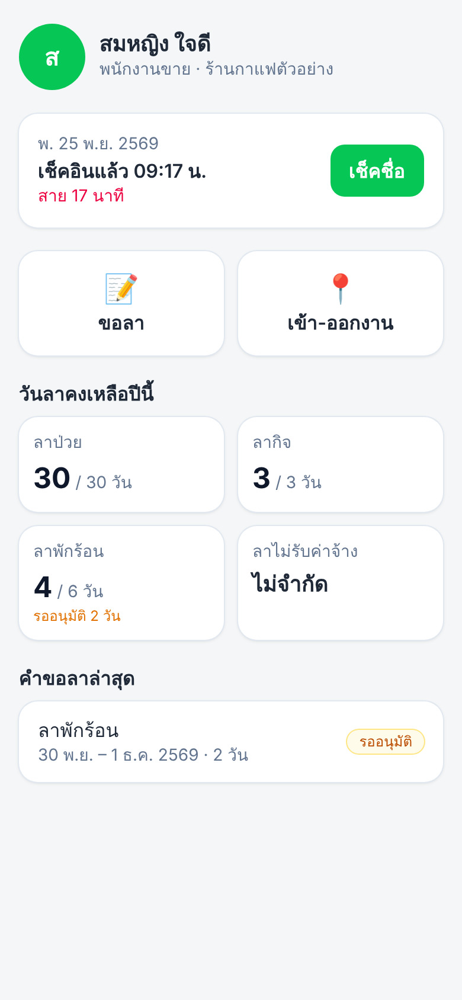
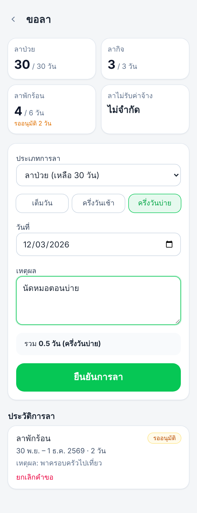
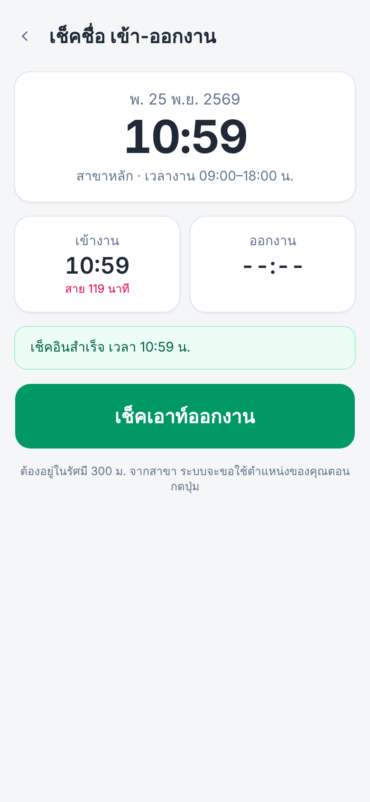
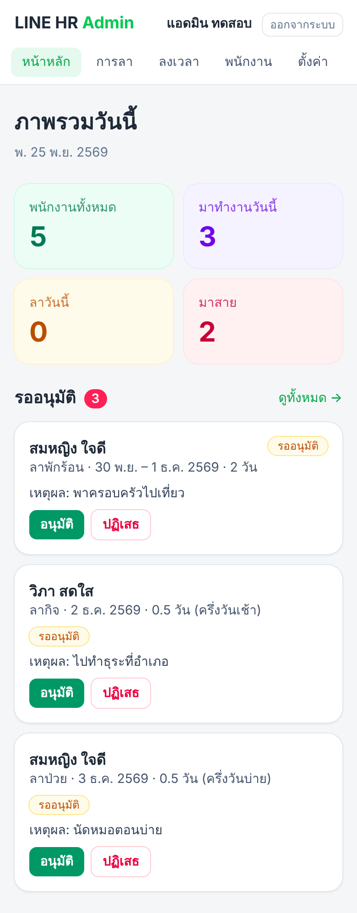
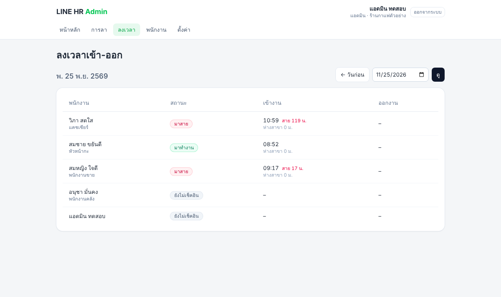

# LINE HR — ระบบลงเวลาและขอลาผ่าน LINE

ระบบ HR สำหรับร้านค้าและธุรกิจขนาดเล็ก ให้พนักงานขอลาและเช็คชื่อผ่าน LINE ได้เลยโดยไม่ต้องติดตั้งแอปเพิ่ม
หัวหน้าได้รับการ์ดแจ้งเตือนในแชทและกด **อนุมัติ / ปฏิเสธ** ได้ทันที ส่วนเจ้าของร้านดูภาพรวมได้จากหน้าเว็บแอดมิน

| หน้าหลักพนักงาน (LIFF) | ฟอร์มขอลา | เช็คชื่อด้วย GPS | แดชบอร์ดแอดมิน |
| --- | --- | --- | --- |
|  |  |  |  |



## ทำอะไรได้บ้าง

**พนักงาน** (ใช้ใน LINE ผ่าน LIFF)
- ลงทะเบียนครั้งแรกด้วย **รหัสเชิญ 8 หลัก** ที่แอดมินออกให้ (ใช้ได้ครั้งเดียว)
- ขอลาแบบเต็มวัน / ครึ่งวันเช้า / ครึ่งวันบ่าย ดูวันลาคงเหลือ และยกเลิกคำขอที่ยังรออนุมัติได้
- เช็คอิน-เช็คเอาท์ด้วย GPS ได้เฉพาะในรัศมีของสาขา ระบบคำนวณนาทีที่มาสายหรือออกก่อนเวลาให้เอง

**หัวหน้างาน / แอดมิน**
- ได้รับ **การ์ดสีส้ม "มีคำขอลาใหม่"** ใน LINE พร้อมปุ่มอนุมัติ / ปฏิเสธที่กดในแชทได้เลย
- พนักงานได้รับ **การ์ดสีเขียว / สีแดง** แจ้งผลกลับทาง LINE อัตโนมัติ
- หน้าเว็บแอดมิน: ภาพรวมวันนี้ (มาทำงาน / ลา / สาย), รายการคำขอลา, ตารางเวลาเข้า-ออกรายวัน,
  จัดการพนักงานและรหัสเชิญ, ตั้งค่าสาขา (พิกัด, รัศมี, เวลางาน), ประเภทการลาและโควตา

**กฎที่ระบบบังคับให้**
- นับวันลาเฉพาะวันทำงานที่ตั้งไว้ (เช่น จ.–ศ.) ลาครึ่งวันนับเป็น 0.5 วัน
- กันลาซ้อนวันกัน (ยกเว้นครึ่งเช้ากับครึ่งบ่ายในวันเดียวกัน) และกันลาเกินโควตาต่อปี (นับคำขอที่รออนุมัติด้วย)
- กดอนุมัติซ้ำ หรือ LINE ส่ง webhook ซ้ำ จะไม่เกิดผลซ้ำ ระบบตอบกลับว่า "ดำเนินการไปแล้ว"
- หัวหน้างานอนุมัติการลาของตัวเองไม่ได้ (แอดมินซึ่งเป็นเจ้าของร้านทำได้)

## การทำงานโดยรวม

```
พนักงาน ── ฟอร์มขอลาใน LIFF ──▶ POST /api/leaves ──▶ บันทึกลง DB (pending)
                                               └──▶ multicast การ์ดสีส้มไปหาหัวหน้า/แอดมิน

หัวหน้า ── กดปุ่ม "อนุมัติ" ในการ์ด ──▶ LINE ──▶ POST /api/line/webhook (postback)
                                               ├──▶ อัปเดต DB (approved)
                                               ├──▶ reply ยืนยันกลับหาหัวหน้า
                                               └──▶ push การ์ดสีเขียวไปหาพนักงาน
```

ผู้ใช้ทุกคนล็อกอินด้วย LINE: หน้า LIFF ส่ง ID token มาให้เซิร์ฟเวอร์ตรวจกับ LINE แล้วออก session cookie (httpOnly)
หน้าแอดมินบนคอมพิวเตอร์ก็ล็อกอินผ่าน LINE Login แบบเดียวกัน

## Tech stack

- **Next.js 16** (App Router, Cache Components) ใช้ได้ทั้งหน้าเว็บ, API และ webhook ในโปรเจกต์เดียว deploy บน Vercel ได้ทันที
- **PostgreSQL + Drizzle ORM** ใช้ได้กับ Neon, Supabase หรือ Postgres ทั่วไป
- **LINE Messaging API** (`@line/bot-sdk`) สำหรับ webhook, Flex Message, push / reply
- **LIFF** (`@line/liff`) สำหรับหน้าเว็บที่เปิดในแอป LINE
- **Tailwind CSS 4** และ **Vitest + PGlite** (เทสต์กับ Postgres จริงที่รันในหน่วยความจำ ไม่ต้องติดตั้งฐานข้อมูล)

## โครงสร้างโปรเจกต์

```
line-hr/
├── drizzle/                      # SQL migration (สร้างจาก src/db/schema.ts)
├── scripts/seed.ts               # สร้างธุรกิจแรก + รหัสเชิญแอดมิน (--demo = ข้อมูลตัวอย่าง)
├── src/
│   ├── db/schema.ts              # ตาราง: businesses, branches, employees, leave_types, leave_requests, attendance
│   ├── lib/
│   │   ├── leave-rules.ts        # นับวันลา / ตรวจลาซ้อน (ใช้ทั้งฝั่งเซิร์ฟเวอร์และหน้า LIFF)
│   │   ├── attendance-rules.ts   # ระยะห่าง GPS, นาทีที่มาสาย / ออกก่อน
│   │   ├── dates.ts              # วันที่แบบไทย (พ.ศ.) และเวลาตาม timezone ของร้าน
│   │   ├── line/
│   │   │   ├── flex.ts           # การ์ด Flex Message (คำขอใหม่ / อนุมัติ / ปฏิเสธ / เมนู)
│   │   │   ├── webhook-handler.ts# จัดการ follow, ข้อความ "เมนู", ปุ่ม postback
│   │   │   ├── signature.ts      # ตรวจ x-line-signature
│   │   │   └── id-token.ts       # ตรวจ ID token จาก LIFF กับ LINE
│   │   └── services/             # logic หลัก: พนักงาน, การลา, ลงเวลา, แดชบอร์ด, ตั้งค่า
│   ├── app/
│   │   ├── api/                  # REST สำหรับหน้า LIFF + /api/line/webhook
│   │   ├── liff/                 # หน้าพนักงาน: /liff, /register, /leave, /checkin, /login
│   │   └── admin/                # หน้าแอดมิน + server actions
│   └── components/
└── tests/                        # unit + integration tests (PGlite)
```

## ลองรันในเครื่อง (ยังไม่ต้องมี LINE)

ต้องมี Node.js 20.9 ขึ้นไป และ PostgreSQL

```bash
cd line-hr
npm install
cp .env.example .env.local
# แก้ .env.local: ใส่ DATABASE_URL, SESSION_SECRET และเปิด ALLOW_DEV_LOGIN=true
npm run db:migrate
npm run db:seed -- --demo        # สร้างร้านตัวอย่าง + พนักงานจำลอง + คำขอลาตัวอย่าง
npm run dev
```

ถ้ายังไม่ได้ใส่ `NEXT_PUBLIC_LIFF_ID` ระบบจะเข้า **โหมดทดสอบ** ให้ล็อกอินเป็นผู้ใช้จำลองผ่าน `?as=`

- แอดมิน: http://localhost:3000/liff/login?next=/admin&as=U_dev_admin
- พนักงาน: http://localhost:3000/liff?as=U_dev_employee (ด้านล่างหน้ามีปุ่มสลับผู้ใช้)

ถ้าไม่ได้ตั้ง `LINE_CHANNEL_ACCESS_TOKEN` ข้อความ LINE จะแค่พิมพ์ลง console (`[line:dry-run]`)
โหมดทดสอบถูกปิดเสมอใน production build แม้จะตั้ง `ALLOW_DEV_LOGIN=true` ไว้ก็ตาม

## ตั้งค่า LINE สำหรับใช้งานจริง

> ⚠️ ต้องสร้าง **Messaging API channel และ LINE Login channel ภายใต้ Provider เดียวกัน**
> เพราะ LINE user ID จะต่างกันในแต่ละ Provider ถ้าไม่ใช่ Provider เดียวกัน ระบบจะจับคู่ผู้ใช้จาก LIFF กับ webhook ไม่ได้

1. **สร้าง LINE Official Account และเปิด Messaging API**
   สร้าง OA ที่ [LINE Official Account Manager](https://manager.line.biz/) → ตั้งค่า → Messaging API → เปิดใช้งาน แล้วเลือก Provider
   จากนั้นใน [LINE Developers Console](https://developers.line.biz/console/) → channel ของ OA นี้:
   - แท็บ Basic settings → **Channel secret** → `LINE_CHANNEL_SECRET`
   - แท็บ Messaging API → ออก **Channel access token (long-lived)** → `LINE_CHANNEL_ACCESS_TOKEN`
   - **Webhook URL** = `https://<โดเมนของคุณ>/api/line/webhook` → เปิด **Use webhook** → กด **Verify**
   - ใน OA Manager ให้ปิด "ข้อความตอบกลับอัตโนมัติ" กันไม่ให้ตอบซ้อนกับบอท

2. **สร้าง LINE Login channel + LIFF app** (Provider เดียวกัน)
   - Basic settings → **Channel ID** → `LINE_LOGIN_CHANNEL_ID`
   - Basic settings → **Linked LINE Official Account** → เลือก OA จากข้อ 1
   - แท็บ LIFF → Add: Size = **Full**, Endpoint URL = `https://<โดเมนของคุณ>/liff`, Scopes = **openid** และ **profile**,
     Add friend option = **On** (ชวนผู้ใช้เพิ่ม OA เป็นเพื่อน เพราะต้องเป็นเพื่อนกับ OA ก่อนถึงจะได้รับข้อความแจ้งเตือน)
   - คัดลอก **LIFF ID** → `NEXT_PUBLIC_LIFF_ID`
   - เปลี่ยนสถานะ channel จาก **Developing** เป็น **Published** ไม่อย่างนั้นจะใช้ได้แค่ผู้ดูแล channel

3. **Rich menu** (ตั้งใน OA Manager → ริชเมนู) ให้แต่ละปุ่มเปิดลิงก์:
   - เช็คชื่อ: `https://liff.line.me/<LIFF_ID>/checkin`
   - ขอลา: `https://liff.line.me/<LIFF_ID>/leave`
   - หน้าหลัก / ประวัติ: `https://liff.line.me/<LIFF_ID>`

   พิมพ์คำว่า "เมนู" ในแชทก็ได้ บอทจะตอบการ์ดเมนูกลับมา

4. **โควตาข้อความ:** การแจ้งเตือนคำขอใหม่ (multicast) และแจ้งผลถึงพนักงาน (push) นับรวมในโควตาข้อความรายเดือนของ OA
   ส่วนข้อความตอบกลับ (reply) เช่น ตอนหัวหน้ากดปุ่มในแชท ไม่นับโควตา ตรวจโควตาปัจจุบันของแพ็กเกจได้ใน OA Manager

## Deploy (Vercel + Neon)

1. สร้างฐานข้อมูล Postgres เช่น Neon (มีใน Vercel Marketplace) ใช้ connection string แบบ pooled
2. Import repo นี้เข้า Vercel แล้วตั้ง **Root Directory = `line-hr`**
3. ใส่ Environment Variables:

   | ตัวแปร | ได้จาก |
   | --- | --- |
   | `DATABASE_URL` | Neon / Supabase |
   | `SESSION_SECRET` | สุ่มเองอย่างน้อย 32 ตัวอักษร (คำสั่งอยู่ใน `.env.example`) |
   | `APP_URL` | URL ของแอป เช่น `https://line-hr.vercel.app` (ใช้ทำลิงก์ในข้อความ LINE) |
   | `LINE_CHANNEL_SECRET`, `LINE_CHANNEL_ACCESS_TOKEN` | Messaging API channel |
   | `LINE_LOGIN_CHANNEL_ID`, `NEXT_PUBLIC_LIFF_ID` | LINE Login channel / LIFF |

   `NEXT_PUBLIC_LIFF_ID` ถูกฝังตอน build ถ้าเปลี่ยนค่าต้อง redeploy

4. รัน migration และสร้างแอดมินคนแรกจากเครื่องตัวเอง (ชี้ไปที่ฐานข้อมูล production):

   ```bash
   DATABASE_URL="postgres://..." npm run db:migrate
   DATABASE_URL="postgres://..." npm run db:seed -- --business "ชื่อร้าน" --admin "ชื่อของคุณ"
   ```

   คำสั่ง seed จะพิมพ์ **รหัสเชิญของแอดมิน** ออกมา ให้เปิด `https://liff.line.me/<LIFF_ID>/register` ใน LINE แล้วกรอกรหัส
   จากนั้นเข้าหน้าแอดมินได้ที่ `https://<โดเมน>/admin` เพื่อตั้งพิกัดสาขาและเพิ่มพนักงาน (ได้รหัสเชิญของแต่ละคน)

## ทดสอบ

```bash
npm test            # 34 tests: กฎการลา, วันที่ไทย, GPS, ลายเซ็น webhook, Flex, และ integration กับ Postgres (PGlite)
npm run typecheck
npm run lint
```

integration tests ครอบคลุม: ลงทะเบียนด้วยรหัสเชิญ, ขอลา + แจ้งหัวหน้า, ลาซ้อน, โควตาเต็ม, สิทธิ์การอนุมัติ (รวมข้ามธุรกิจ),
อนุมัติผ่านปุ่ม postback, กดซ้ำ, เช็คอินในและนอกพื้นที่, สรุปรายวันของแดชบอร์ด

## API

| Method | Path | ใช้ทำอะไร |
| --- | --- | --- |
| POST | `/api/auth/line` | แลก LIFF ID token เป็น session cookie |
| POST | `/api/register` | ผูกบัญชี LINE ด้วยรหัสเชิญ |
| GET / POST | `/api/leaves` | วันลาคงเหลือและประวัติ / ส่งคำขอลา |
| POST | `/api/leaves/:id/cancel` | ยกเลิกคำขอที่ยังรออนุมัติ |
| GET / POST | `/api/attendance` | สถานะวันนี้ / เช็คอิน-เช็คเอาท์ |
| POST | `/api/line/webhook` | Webhook ของ LINE (ตรวจลายเซ็นทุกครั้ง) |

หน้าแอดมินใช้ Server Actions ซึ่งตรวจสิทธิ์จาก session ทุกครั้ง และจำกัดข้อมูลตาม `business_id` ของผู้ใช้

## ข้อจำกัดและสิ่งที่ทำต่อได้

- **เงินเดือนและสลิป** (ประกันสังคม, หัก ณ ที่จ่าย, หักขาด/ลา/สาย, เบิกล่วงหน้า) ยังไม่ได้ทำ
  ข้อมูลลา (`leave_types.paid`) และเวลาสาย / ออกก่อน (`attendance`) ที่เก็บไว้พร้อมใช้คำนวณในขั้นต่อไป
- ยังไม่มีวันหยุดนักขัตฤกษ์ (ตอนนี้นับวันทำงานตามวันในสัปดาห์), กะงานข้ามเที่ยงคืน, OT, ลารายชั่วโมง และแนบใบรับรองแพทย์
- GPS ปลอมได้ด้วยแอปจำลองตำแหน่ง ถ้าต้องการเข้มขึ้นให้เพิ่มถ่ายรูปตอนเช็คอิน หรือสแกน QR ที่ร้าน
- บัญชี LINE หนึ่งบัญชีผูกได้กับพนักงานหนึ่งคน (หนึ่งธุรกิจ) และยังไม่มี rate limit ที่หน้ากรอกรหัสเชิญ
- Rich menu ต้องตั้งเองใน OA Manager
